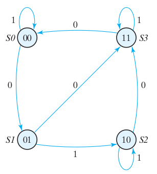

### Demo

The Demo shows a small state machine with the inputs X and Y, one D flip-flop and the output A (the state diagram is shown on the right). The state of the machine is A: it changes when X and Y are different (inputs 01 and 10) and stays when they are equal (inputs 00 and 11). The circuit is D = A XOR (X XOR Y).

1. Click on **Start**. The streams of the inputs X and Y move through the circuit one bit pair at a time, and the output A shows the new state after every clock pulse. The yellow bit of each stream is the one being processed.
2. The same button pauses and resumes the run, and the speed can be changed (1x, 2x, 4x) while it runs. At the end the table of the states and outputs is shown.
3. When the run has finished, click on **Start** to run it again. **Reset** brings the circuit back to its starting state at any time.

### Practice

The Practice page has two tasks, one for each tab: **State Diagram** and **Pattern Identifier**. In both tasks the input X, the clock Clk and the output bits A and B are already on the circuit board, and you build the state machine between them from JK flip-flops and gates. The pair of output bits A B is the state of the machine.

#### General instructions

- Click on a component in the **Components** panel to add it to the board, drag it to move it, and connect components by dragging from one endpoint (the dots) to another. A wire can be dragged from an output point to an input point or the other way round. An output point can drive several inputs; an input point takes one wire only.
- The JK flip-flop has the inputs J (upper), clk (middle) and K (lower) and the outputs Q (upper) and Q' (lower). The flip-flops are **negative-edge triggered**: they change at the moment the clock goes from 1 to 0. Every simulation starts in the state A B = 00.
- To delete a wire or a component, right click on it and select **Delete**.
- The input X is driven by an **input string** of 0s and 1s, one bit for every clock pulse. Every task starts with a default string, which is shown in the Observations panel. Click on **Input** to enter another string (only 0, 1, T and F are accepted).
- Click on **Simulate** to start the clock Clk (one pulse every 2 seconds). The next bit of the string is applied to X when the clock goes up, and the flip-flops change when the clock goes down. The button now reads **Stop**: click on it to stop the clock. **Reset** stops the clock too, and so does a change of tab. The **Submit** and **Input** buttons work only when the clock is stopped.
- Click on **Submit** to check the circuit. Submit uses its own input string, starting from the state 00, and shows a table with the expected and the observed outputs A B after every input bit. A "Success" or "Fail" message is shown. The circuit must be completely connected, otherwise the component that is not connected properly is highlighted.

#### Task 1: State Diagram

_Figure 1: The state diagram of Task 1. The states are S0 = 00, S1 = 01, S2 = 10 and S3 = 11 (the pair A B), and the arrows are labelled with the input X. Reference: Theory section_

**State table** (the present state is A B, the next state is A⁺ B⁺):

| A B | X = 0 | X = 1 |
| --- | ----- | ----- |
| 00  | 01    | 00    |
| 01  | 11    | 10    |
| 10  | 11    | 10    |
| 11  | 00    | 11    |

**Flip-flop inputs** (found with the JK excitation table, as in the Theory section):

- J_A = B, K_A = B · X'
- J_B = X', K_B = A XOR X

**Components required:** 2 JK flip-flops (one for A, one for B), 1 NOT gate, 1 AND gate and 1 XOR gate.

**Circuit connections:**

1. Drag two JK flip-flops. Call the first one FF A and the second one FF B. Connect the Q output of FF A to the output bit **A** and the Q output of FF B to the output bit **B**.
2. Connect the **Clk** bit to the clk input of both flip-flops.
3. Drag a NOT gate and connect its input to **X**. Its output is X'.
4. Connect the Q output of FF B to the J input of FF A.
5. Drag an AND gate and connect its inputs to the Q output of FF B and to the output of the NOT gate. Connect its output to the K input of FF A.
6. Connect the output of the NOT gate to the J input of FF B.
7. Drag an XOR gate and connect its inputs to the Q output of FF A and to **X**. Connect its output to the K input of FF B.
8. Click on "Simulate" and follow the outputs for the input string, then click on "Submit".

**Expected behaviour** (checked when you click on "Submit"; the machine starts in the state 00):

| Step | X | A B |
| ---- | - | --- |
| 1    | 1 | 0 0 |
| 2    | 0 | 0 1 |
| 3    | 1 | 1 0 |
| 4    | 1 | 1 0 |
| 5    | 0 | 1 1 |
| 6    | 0 | 0 0 |
| 7    | 0 | 0 1 |
| 8    | 0 | 1 1 |
| 9    | 1 | 1 1 |
| 10   | 0 | 0 0 |

A circuit that gives the state code with A and B exchanged is accepted too.

#### Observations

- The outputs A B are the state of the machine. After every clock pulse they change as the state diagram says for the present state and the input X.
- The JK flip-flops store the state, and the gates in front of them are the next-state logic.
- If the circuit has been made as described above, a "Success" message is displayed upon clicking "Submit".

#### Task 2: Pattern Identifier

Design a state machine that finds a run of **3 or more 1s** in the input stream: the outputs A B have to be **1 1 while the last three (or more) inputs were 1**, and they can have any other value than 1 1 at all the other times. You have to draw the state diagram yourself and design the circuit.

**One possible design.** Let the state be the number of 1s in a row so far, up to 3: 00 (none), 01 (one), 10 (two) and 11 (three or more). A 1 moves the machine to the next state (11 stays in 11) and a 0 brings it back to 00:

| A B | X = 0 | X = 1 |
| --- | ----- | ----- |
| 00  | 00    | 01    |
| 01  | 00    | 10    |
| 10  | 00    | 11    |
| 11  | 00    | 11    |

The JK inputs are J_A = X · B, K_A = X', J_B = X, K_B = (X · A)'. The components are 2 JK flip-flops, 2 AND gates and 2 NOT gates (the output of the second AND gate goes through a NOT gate to K_B).

Any other design is accepted, whatever the state codes are, as long as A B = 1 1 exactly while the last three or more inputs were 1 (the check uses a string with runs of 1s of the lengths 1, 4, 1, 2 and 3).

**Circuit connections (for the design above):**

1. Drag two JK flip-flops (FF A and FF B). Connect their Q outputs to the output bits **A** and **B**, and the **Clk** bit to both clk inputs.
2. Drag an AND gate and connect its inputs to **X** and the Q output of FF B. Connect its output to the J input of FF A.
3. Drag a NOT gate and connect its input to **X**. Connect its output to the K input of FF A.
4. Connect **X** to the J input of FF B.
5. Drag a second AND gate and connect its inputs to **X** and the Q output of FF A. Drag a second NOT gate and connect its input to the output of this AND gate. Connect the NOT output to the K input of FF B.
6. Click on "Simulate", enter strings with the Input button and watch A B reach 1 1 after the third 1 in a row, then click on "Submit".

#### Observations

- A B is 1 1 from the third 1 of a run of 1s until the next 0, and the pattern can overlap (a run of 4 or more 1s keeps A B at 1 1).
- A 0 in the input always brings the machine back to the starting state.
- If the circuit has been made correctly, a "Success" message is displayed upon clicking "Submit".

#### Troubleshooting

- **"highlighted component not connected" or "... of Flip-Flop must be connected"**: every input and output of every component has to be connected, and the Q output of every flip-flop has to drive something.
- **Simulate shows nothing**: wait for the first clock pulse (up to 2 seconds). The outputs change when the clock goes down.
- **Submit fails, but the simulation looks right**: Submit starts from the state 00 and uses its own input string; check the table to see in which step the outputs differ from the expected ones.
- **Input does not accept my string**: the string has to contain only 0s and 1s (or T and F).
